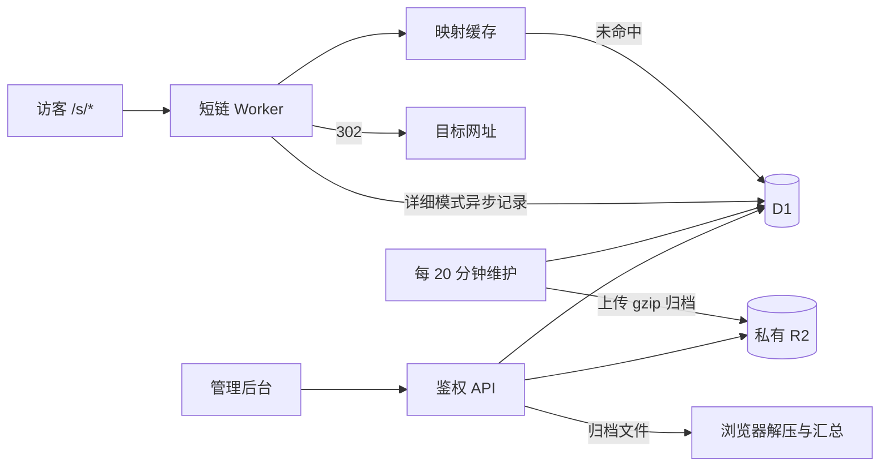

# 实现说明

[返回项目首页](../README.md) · [开发指南](development.md) · [配置与运维](operations.md) · [OpenAPI](openapi.yaml)

## 请求与存储

后台静态资源和 API 部署在同一个 Cloudflare Worker。`/s`、`/s/*` 和 `/api/*` 优先进入 Worker，后台由静态资源提供。D1 保存短链、近期访问和归档目录，私有 R2 保存已压缩的历史明细。



经济模式不记录访问或更新点击计数，映射缓存命中后不访问 D1/R2。详细模式使用相同缓存，每次成功 GET 跳转通过 `waitUntil()` 插入一条明细；HEAD 不计数。采集失败会记入日志，已解析的跳转继续返回；异步采集可能丢失事件。D1 不可用且缓存未命中时返回 503。

## 短链与映射缓存

- 自定义路径只允许 ASCII 字母、数字、`-`、`_` 及 `/` 分层，区分大小写，最长 256 字符；禁止空段、编码分隔符和路径穿越。
- 留空生成 8 位随机短码，采用拒绝采样避免取模偏差；数据库唯一约束处理冲突，最多尝试 5 次。
- 目标仅支持 HTTP/HTTPS，不允许账号密码、空白/控制字符或本站 `/s` 路径。创建和更新时校验原始输入长度不超过 2048 字符，再存储 URL 规范化结果。
- GET/HEAD 返回 302。保留目标网址原有查询参数，再追加短链请求的 query；同名参数均保留，并保持参数顺序、重复项和原始编码，目标片段（`#...`）保留在最后。其他请求方法返回 405。
- 缓存保存映射而非 302 响应：有效映射缓存 60 秒，未找到的结果缓存 10 秒。查询参数不参与缓存键。
- 映射保存绝对失效时间，以数据库读取开始时间为起点，避免延迟写入缓存延长旧数据的有效期。
- 管理操作清理当前节点缓存，其他节点按 TTL 更新。修改、停用和删除最多需要 60 秒生效。
- 跳转响应带 `Cache-Control: no-store`。不要对 `/s/*` 配置绕过 Worker 的整页缓存，否则可能漏记统计或继续返回旧跳转。

## 数据表

| 表              | 内容与约束                                                             |
| --------------- | ---------------------------------------------------------------------- |
| `links`         | UUID 标识、路径、目标、标题和启用状态；仅未删除路径唯一                |
| `events`        | 自增事件 ID、短链 ID、访问时域名、路径与 query、时间、访客信息和去重键 |
| `archive_days`  | 每日归档状态、游标、分片数量、行数和压缩字节数                         |
| `archive_parts` | R2 对象键、固定记录边界、行数、SHA-256、上传状态                       |
| `maintenance`   | 单行租约、执行令牌、最近运行结果与错误                                 |

删除短链使用墓碑保留历史归属。路径可以重新使用，新链接获得新 ID；统计按 ID 区分。超过统计保留期的旧墓碑在空闲维护阶段清理。访问表的时间索引和“短链 ID + 时间”索引用于按日期、短链筛选及游标翻页，事件自增 ID 不因旧记录清空而复用。

## 统计口径

明细保存原始 IP、UTC 毫秒时间戳、当时的访问域名与路径、Cloudflare 提供的地区、来源域名、User-Agent、浏览器和设备类别。访问域名 `hostname` 为必填非 NULL 字段，无默认值，取自每次请求 URL 的主机名，不含协议和端口，同一 Worker 绑定多个域名时分别记录，并随明细一起归档；来源 URL 的路径和参数不保存。User-Agent 最多 512 字符。浏览器与设备通过轻量规则分类。

详细模式还记录短链请求附带的原始 query（不含开头的 `?`），保留参数顺序、重复项和编码；不包含目标网址预设的查询参数，无参数时保存空字符串。`query` 字段不可为 NULL，随明细一起归档，并显示在后台“访问详情”弹窗中。

所有成功 GET 均计入 PV，包括机器人和预览请求。每日 UV 按 `IP + User-Agent` 的 SHA-256 去重；缺少 IP 时只计 PV。后台展示所选日期范围的日均 UV，包含无访问日期，不将跨日 UV 直接相加称为独立访客数。

日期分组使用 UTC，明细时间按浏览器本地时区显示。切回经济模式不会删除已有统计，经济模式期间的访问不补录。

统计接口在同一个 D1 `batch()` 中查询近期汇总与归档日期，统一数据来源。只有未发布归档的日期计入 D1 汇总；发布后的日期通过 R2 计算，即使源明细尚未删除也不会重复统计。接口返回的归档目录不受短链筛选影响，客户端需按 `link_id` 筛选归档内容。

## 归档与恢复

Cron 固定为 `*/20 * * * *`，每天 72 次。一次维护只推进一个有限阶段，按以下优先级执行：

1. 清理超过总保留期限的归档，每次最多删除 100 个 R2 对象。
2. 清理超过总保留期限的 D1 明细，每次最多 1000 条。
3. 清理已发布归档对应的 D1 明细，每次最多 1000 条。
4. 继续未完成上传，或选择早于“今天 UTC 零点减 14 天”的最早日期开始上传。
5. 全日上传完成后发布目录；下次维护才允许删除源明细。无其他工作时清理旧短链墓碑。

单批默认最多 500 条记录、512 KB 未压缩内容。`ARCHIVE_BATCH_SIZE` 和 `ARCHIVE_MAX_KB` 同时限制新分片，KB 按 1024 字节换算；大小包含文件头、UTF-8 编码后的事件内容和换行。

维护租约为 2 分钟。更新目录、游标和删除源数据时检查租约令牌，避免过期执行者提交结果。失败保留源数据与检查点，记录 `last_error`，下次调度继续重试。

上传前先预留分片边界及 SHA-256，再以条件写入将对象上传到 R2。重试会重新编码固定范围的事件并核对校验和；已存在的对象按元数据和大小验证。调整行数或 KB 上限只影响新分片，待重试分片仍按原边界完成。源记录变化或校验失败会中止处理，保留 D1 明细。

日目录状态依次为 `uploading` → `published` → `cleaned`，过期清理使用 `deleting`。单片状态为 `pending` → `ready`；只有全日发布后，后台才能读取该日分片。

### R2 文件格式

```text
analytics/v1/YYYY/MM/DD/part-000000.jsonl.gz
```

每个文件是 gzip 压缩的 NDJSON。首行为版本与 UTC 日期，后续每行一条 `Visit`，字段定义见 [OpenAPI](openapi.yaml) 中的 `ArchiveHeader` 和 `Visit`：

```json
{ "schemaVersion": 1, "day": "2026-10-01" }
```

D1 目录保存对象键、事件边界、记录数、压缩字节数及压缩文件 SHA-256。下载接口返回 `application/gzip`，不设置 `Content-Encoding`，由浏览器显式解压。

### 历史查询

浏览器 Web Worker 经鉴权接口分页读取目录、逐片下载，校验 SHA-256、压缩大小、版本、日期和记录数，再执行解压、筛选及汇总。汇总期间只保留单个日期的去重集合；历史明细按日逆序翻页，每页 50 条，翻页可能重复下载分片。

取消历史汇总后，界面标识部分结果。归档明细不写入 localStorage 或 IndexedDB。若查询 D1 明细时对应日期刚发布，接口返回 409，前端改读归档。

## 保留期限

默认保留含今天在内的 180 个 UTC 日期。过期日期先禁止查询，再由维护任务物理删除。缩短保留期限会永久删除超期数据；延长期限无法恢复已删除数据。统计保留策略不改变 Cloudflare 数据库备份或 Time Travel 自身的保留设置。
